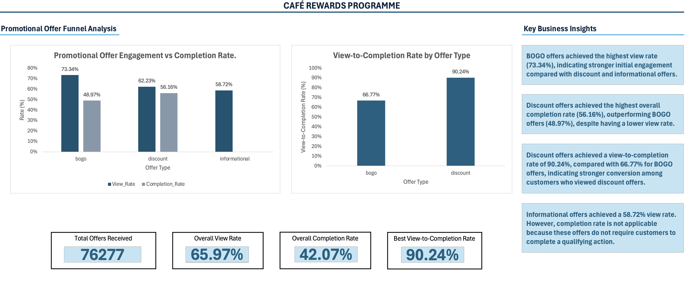

# Café Rewards Programme – Promotional Offer Funnel Analysis

## Project Overview

An Excel-based data analysis project investigating customer engagement and promotional offer completion within a café rewards programme.

## Tools Used
- Microsoft Excel
- Power Query
- Excel Charts and Dashboards

## Dashboard Preview

## Key Results

| Metric | Result |
|---|---:|
| Offers Received | 76,277 |
| Offers Viewed | 50,322 |
| Offers Completed | 32,087 |
| Overall View Rate | 65.97% |
| Overall Completion Rate | 42.07% |

## Key Findings

- BOGO offers achieved the highest view rate (73.34%).
- Discount offers achieved the highest completion rate (56.16%).
- Discount offers achieved a 90.24% view-to-completion rate.
- Informational offers achieved a 58.72% view rate.

## Project Files

- [Download Project Report](Café%20Rewards%20Programme%20Report.docx)
- [Access Excel Workbook](https://docs.google.com/spreadsheets/d/1xupNXrwGP36r2L1dgKA4AyNirNMb93TX/edit?usp=sharing)

## Conclusion

This project demonstrates data profiling, data preparation, Power Query transformations, funnel analysis, KPI calculations and dashboard visualization to generate meaningful business insights.
